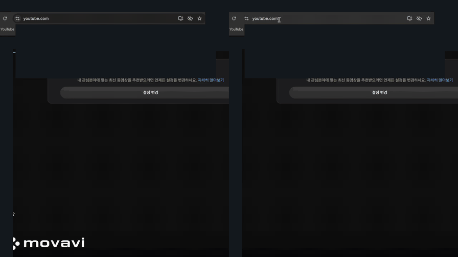

# ZoroSpoiler

데스크톱 Chrome에서 유튜브 스포일러 댓글을 가리는 확장 프로그램입니다. 유튜브에서 스크립트(자막)를 불러올 수 있는 일반 동영상을 열면, 자막을 읽어 로드된 댓글을 자동으로 판정합니다. 영상 등록은 필요 없습니다.

## 실제 Chrome 데모

38초 편집본이 아래에서 자동으로 반복됩니다. 댓글을 여는 장면에는 실제 스포일러가 잠시 표시됩니다.



<details>
<summary>MP4 플레이어 열기</summary>

https://github.com/user-attachments/assets/16dd0892-2bdb-4883-b81e-506eeb83e56d

</details>

| 영상 | 열어본 방법 |
| --- | --- |
| 〈식스센스〉 | Chrome 주소창에 유튜브 영상 주소 입력 |
| 〈연애박사〉 | 유튜브에서 연애박사를 검색해 12회 하이라이트 클릭 |

영상마다 **왼쪽은 확장을 켠 댓글창**, **오른쪽은 확장을 끈 댓글창**입니다. 왼쪽에서는 **스포일러 의심 · 보기**로 댓글을 열고 다시 가릴 수 있습니다. 오른쪽에서는 댓글 본문이 그대로 보입니다.

## 빠른 시작

### 1. Chrome에 설치

```sh
git clone https://github.com/AllForJoon/zoroSpoiler.git
```

Chrome에서 `chrome://extensions`를 열고 **개발자 모드 → 압축해제된 확장 프로그램을 로드합니다**를 선택합니다. 다운로드한 저장소의 `extension/` 폴더를 엽니다. 기존 설치를 업데이트할 때는 저장소를 업데이트한 뒤 ZoroSpoiler 카드의 새로고침 버튼을 누릅니다.

### 2. Zoro-1에 연결

Zoro-1은 자신이 사용하는 컴퓨터나 원격 실행 환경에서 시작합니다. 그런 다음 [서버 실행](#서버-실행)에 따라 ZoroSpoiler 앱 서버를 모델과 연결하고, Chrome 확장의 **세부정보 → 확장 프로그램 옵션**에서 배치 방식에 맞는 항목을 선택합니다.

| 확장 옵션 | Chrome에서 접속하는 앱 서버 주소 | 연결 방식 |
| --- | --- | --- |
| **원격 Zoro-1** (기본값) | `127.0.0.1:8876` | 사용하는 서비스의 터널이나 포트 포워딩을 통해 연결 |
| **로컬 Zoro-1** | `127.0.0.1:8878` | Chrome과 같은 컴퓨터에서 실행 |

### 3. 유튜브에서 확인

1. [〈연애박사〉 시연 영상](https://www.youtube.com/watch?v=nv3AS41lVKw)을 열고 댓글창으로 스크롤합니다. 확장 설치 전에 열어둔 탭은 새로고침합니다.
2. 댓글창 맨 위의 **스포일러 댓글 보기**를 눌러 가려진 댓글을 표시합니다.
3. 같은 자리의 **스포일러 댓글 가리기**를 누르면 다시 가립니다. 개별 댓글도 바로 표시하거나 가릴 수 있습니다. 긴 댓글의 버튼은 유튜브 **더보기** 바깥에 있습니다.

## 댓글이 표시되는 기준

| 상태 | 기본 표시 |
| --- | --- |
| 판정 중 | 가림 |
| 일반 댓글 | 본문 표시 |
| 스포일러 또는 판정 보류 | 가림. 상단 토글 또는 개별 버튼으로 표시 가능 |
| 스크립트를 불러올 수 없는 영상 | 유튜브 댓글을 그대로 표시 |

시청 위치와 관계없이 가림 상태는 토글로 제어합니다. 연결에 실패하면 댓글창 상단 안내의 **다시 시도**로 판정을 재개합니다.

Chrome 확장은 유튜브에서 자막을 읽어 현재 페이지에 로드된 댓글과 함께 앱 서버로 보냅니다. 원격 옵션에서는 설정한 터널이나 포트 포워딩을 통해, 로컬 옵션에서는 같은 컴퓨터의 루프백 주소로 전달합니다. 앱 서버가 Zoro-1을 호출해 판정 상태를 반환합니다. 댓글에 회차가 명시되면 해당 회차로 확인된 자막을 근거로 사용합니다.

## 서버 실행

### 원격 서버에서 실행

사용 중인 서비스나 서버의 안내에 따라 Zoro-1 typed decision 엔드포인트를 실행합니다. ZoroSpoiler 앱 서버를 시작할 때 `--zoro-url`에 앱 서버에서 접근할 수 있는 모델 주소를 지정합니다. 아래 예시는 두 서버가 같은 컴퓨터에서 실행되고 Zoro-1이 `30001` 포트를 사용하는 경우입니다. [Zoro-1 모델 서버 실행 방법](https://huggingface.co/trillionlabs/Zoro-1#using-the-typed-decision-head)

```sh
python3 -m server serve --zoro-url http://127.0.0.1:30001/v1/decide
```

Chrome이 실행되는 컴퓨터의 `127.0.0.1:8876`에서 앱 서버에 접속할 수 있도록, 사용하는 환경의 연결 방법을 적용합니다. SSH를 쓰는 경우 아래 명령의 `USER@HOST`를 자신의 서버 주소로 바꿉니다. 원격 연결은 시청하는 동안 유지합니다.

```sh
ssh -N -L 8876:127.0.0.1:8876 USER@HOST
```

### Chrome과 같은 컴퓨터에서 실행

[Hugging Face의 Zoro-1 모델 페이지](https://huggingface.co/trillionlabs/Zoro-1)에서 파일 접근 권한을 받은 뒤 저장소에서 실행합니다.

```sh
python3 -m venv .venv
source .venv/bin/activate
python3 -m pip install -r server/requirements-local.txt
hf auth login
python3 -m server serve --local-model
```

앱 서버가 `8878`에서 실행되면 확장 옵션에서 **로컬 Zoro-1**을 선택합니다. 가중치를 이미 다운로드했다면 `--checkpoint /path/to/snapshot`으로 지정할 수 있습니다. 별도 Zoro-1 판정 서버를 사용한다면 다음과 같이 연결합니다.

```sh
python3 -m server serve --port 8878 --zoro-url http://127.0.0.1:30001/v1/decide
```

## 개발과 연결 확인

- `extension/`에는 Chrome 확장, 자막 수집, 댓글 UI가 있습니다.
- `server/`에는 자막 근거 추출, Zoro-1 판정, API와 테스트가 있습니다.
- `curl -fsS http://127.0.0.1:8876/health`는 Chrome이 실행되는 컴퓨터에서 원격 앱 서버까지 연결됐는지 확인합니다. 로컬 모드는 `8878` 포트를 사용합니다. 실제 모델 판정은 시연 영상에서 일반 댓글이 표시되고 스포일러 댓글이 가려지는지 확인합니다.

```sh
python3 -m unittest discover
```
